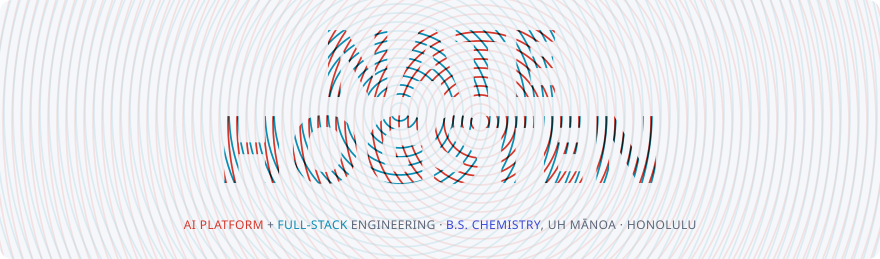
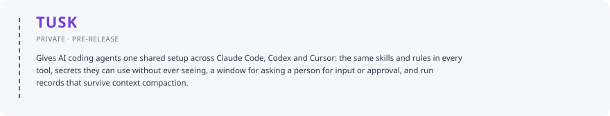

<picture>
  <source media="(max-width: 600px) and (prefers-color-scheme: dark)" srcset="assets/hero-dark-narrow.svg">
  <source media="(max-width: 600px)" srcset="assets/hero-light-narrow.svg">
  <source media="(prefers-color-scheme: dark)" srcset="assets/hero-dark.svg">
  
</picture>

<picture>
  <source media="(max-width: 600px) and (prefers-color-scheme: dark)" srcset="assets/bio-dark-narrow.svg">
  <source media="(max-width: 600px)" srcset="assets/bio-light-narrow.svg">
  <source media="(prefers-color-scheme: dark)" srcset="assets/bio-dark.svg">
  
</picture>

<picture>
  <source media="(max-width: 600px) and (prefers-color-scheme: dark)" srcset="assets/skills-dark-narrow.svg">
  <source media="(max-width: 600px)" srcset="assets/skills-light-narrow.svg">
  <source media="(prefers-color-scheme: dark)" srcset="assets/skills-dark.svg">
  
</picture>

<picture>
  <source media="(max-width: 600px) and (prefers-color-scheme: dark)" srcset="assets/tusk-dark-narrow.svg">
  <source media="(max-width: 600px)" srcset="assets/tusk-light-narrow.svg">
  <source media="(prefers-color-scheme: dark)" srcset="assets/tusk-dark.svg">
  
</picture>
